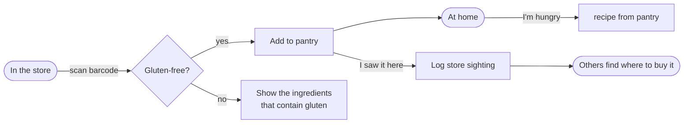
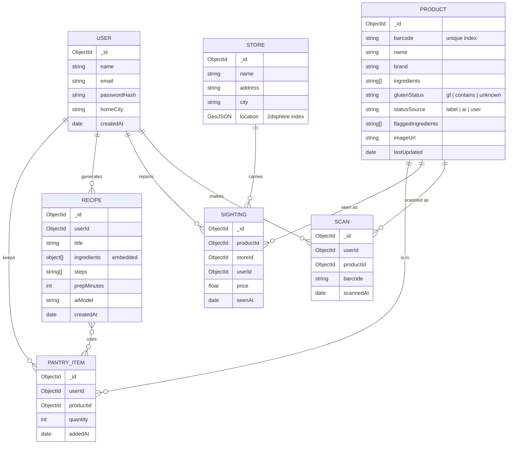
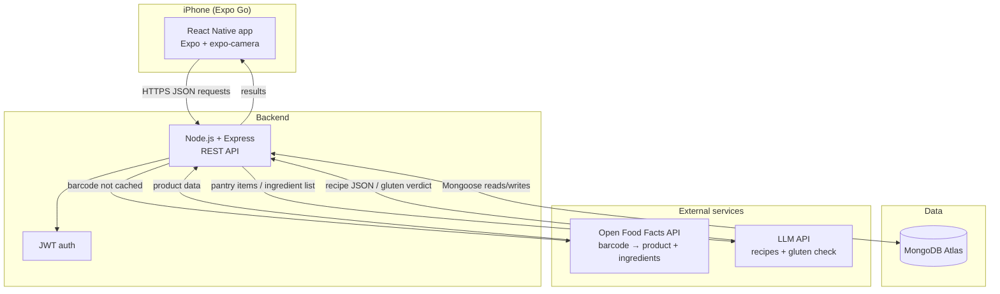

# Gluten-Free Locator — Project Plan

**CS 452 Final Project · Andre Aguirre**

> An iPhone app that helps people who eat gluten-free answer three questions fast:
> **"Can I eat this?"**, **"What can I make with what I have?"**, and **"Where can I buy it?"**

---

## 1. Purpose & Goals

### Why
My wife suffers from Hashimoto disease. This is a immunodeficiency disease that causes gluten intolerance. She constantly has to find replacements for her food, reading every label in the store aisle, figuring out a snack from what's in the pantry, or remembering which store carried those gluten-free cinnamon rolls. Gluten-Free Locator solves these issues.

### What it does

| Feature | What the user does | What happens |
|---|---|---|
|  **Scan** | Points the camera at a product barcode | App looks up the product and shows **Gluten-free / Contains gluten / Unknown**, with the ingredients that caused the verdict |
|  **Pantry** | Saves gluten-free foods they have at home | Builds a personal list of safe foods, that the user can update as being used. |
|  **Recipe ideas** | Taps "Feeling Gluten-Free" | Generates a recipe from a database, user can provide their own recipes |
|  **Store finder** | Reports "I saw this product at this store" | Other users can search a product and see which local stores carry it with a map-like service |

### Goals for the class
- **Read & write data** in MongoDB across several related collections (users, products, pantry, recipes, stores, sightings)
- **Use AI**  classify gluten risk from an ingredient list when a product has no clear label
- Ship a working app on my phone through **Expo Go** by the end of class

### Stretch goals (only if time allows)
- Map view of nearby stores
- Upvote / "still in stock" confirmations on store sightings
- Photograph an ingredient label when the barcode isn't found (OCR → AI check)

### How it fits together (user's view)

---

## 2. Initial ERD

MongoDB is document-based, so this ERD shows **collections** and the references between them (stored as `ObjectId` fields). A few things are embedded where they're always read together (e.g. a recipe's ingredient list).

**Key queries this has to support**
- Look up a product by `barcode` (unique index) → fast scan results
- "Which stores carry product X near me?" → `sightings` filtered by `productId`, joined to `stores` with `$lookup`, sorted by most recent `seenAt`
- "What's in my pantry?" → `pantry_items` by `userId`, joined to `products`
- Recipe history per user, newest first

---

## 3. System Design

**Scan flow, step by step**
1. Phone camera reads the barcode → app sends `GET /products/:barcode`
2. API checks MongoDB first (cache)
3. If not found → fetch from Open Food Facts → save to `products`
4. If the label doesn't clearly say gluten-free → send the ingredient list to the LLM → store verdict with `statusSource: "ai"`
5. Return the verdict to the phone and log a `scan`

**Main API routes (draft)**

| Method | Route | Purpose |
|---|---|---|
| POST | `/auth/register`, `/auth/login` | Accounts |
| GET | `/products/:barcode` | Scan lookup |
| GET/POST/DELETE | `/pantry` | Manage pantry |
| POST | `/recipes/generate` | AI recipe from pantry |
| GET | `/recipes` | Recipe history |
| GET | `/products/:id/stores` | Where to buy |
| POST | `/sightings` | Report product at a store |

---

## 4. Daily Goals (Nov 19 → end of class)

~1.5–2.5 hours per working day. Hours are tracked in `hours.md`.

| Date | Goal |
|---|---|
| **Wed Nov 19** | Write this plan; set up repo structure (`/app`, `/server`), README, `hours.md` |
| **Thu Nov 20** | MongoDB Atlas cluster + Express server running; Mongoose models for all 6 collections |
| **Fri Nov 21** | Seed script with sample products & stores; barcode unique index; `GET /products/:barcode` reads from DB |
| **Sat Nov 22** | Open Food Facts integration + caching new products into MongoDB |
| **Mon Nov 24** | Expo app scaffold, tab navigation (Scan / Pantry / Recipes / Stores), camera barcode scanner working |
| **Tue Nov 25** | Connect scanner → API → show verdict screen |
| **Sat Nov 29** | Auth (register/login, JWT) on server + login screen in app |
| **Mon Dec 1** | Pantry: add from scan result, list, delete (full CRUD) |
| **Tue Dec 2** | AI #1: LLM gluten check for products with unclear labels |
| **Wed Dec 3** | AI #2: recipe generation from pantry → save to `recipes`; recipe screen |
| **Thu Dec 4** | Stores + sightings: report a sighting, `$lookup` query for "where to buy" |
| **Fri Dec 5** | Store finder screen; sort by most recent / nearest |
| **Sat Dec 6** | Bug-fix day; real-world test with my wife at the grocery store |
| **Mon Dec 8** | UI polish, error states (no network, unknown barcode) |
| **Tue Dec 9** | Final README with screenshots, ERD + diagrams updated to match what was built |
| **Wed Dec 10** | Demo video / presentation prep, submit |

*Dates to adjust once I confirm the exact final due date.*

---

When a product **contains gluten**, the verdict screen turns red and lists the flagged ingredients (e.g. *wheat flour, barley malt*).

---

## Tech Stack Summary
- **Frontend:** React Native (Expo, run in Expo Go on iPhone), `expo-camera` for barcode scanning
- **Backend:** Node.js + Express, Mongoose, JWT
- **Database:** MongoDB Atlas
- **External:** Open Food Facts API (product data), LLM API (recipes + gluten classification)
