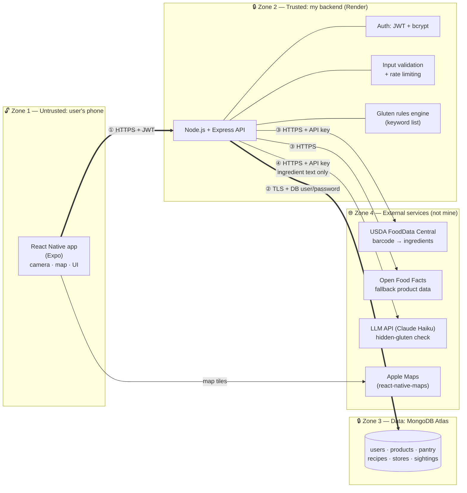
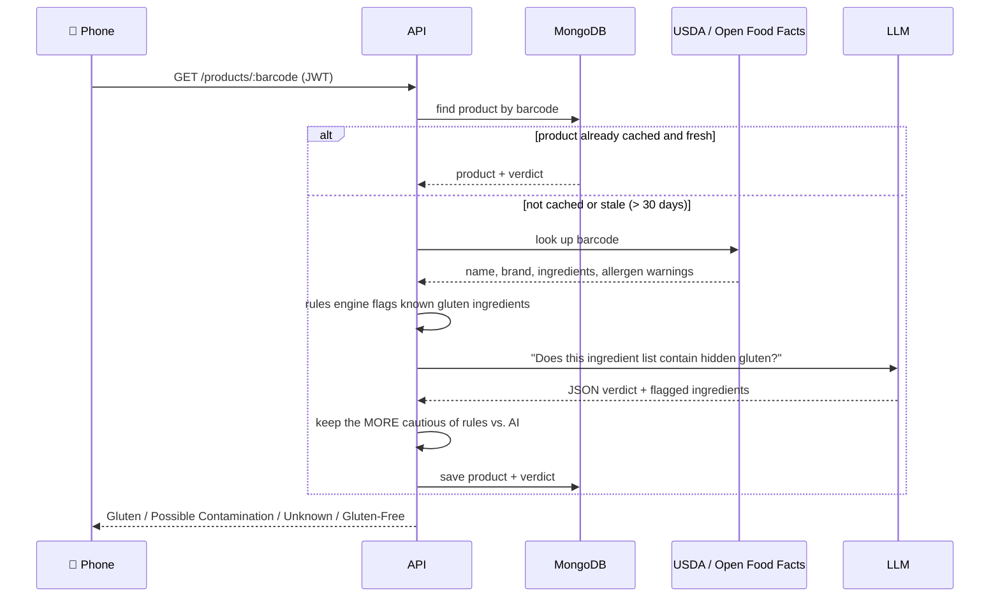

# Gluten-Free Locator — System Design

This document covers the technology choices, security boundaries, scaling plan and costs for Gluten-Free Locator. ([Project plan](PROJECT_PLAN.md))

---

## 1. Architecture Diagram

The dashed boxes are **trust zones**. Every arrow that crosses a zone border is a **security boundary**, and the API checks or protects whatever crosses it.

### What happens when a barcode is scanned

---

## 2. Technology Choices

| Layer | Choice | Why | Alternatives considered |
|---|---|---|---|
| Mobile app | **React Native + Expo** (Expo Go for testing) | One JavaScript codebase; Expo Go runs it on my iPhone without a Mac build or Apple developer account; `expo-camera` handles barcode scanning | Swift (iOS only, new language), Flutter (Dart) |
| Backend | **Node.js + Express** | Same language as the app; simple REST API; keeps API keys off the phone | Firebase functions, Python/FastAPI |
| Database | **MongoDB Atlas** | Product data from USDA/Open Food Facts is already JSON with varying fields; built-in geospatial queries (`2dsphere`) for "shops near me"; free tier; I've used MongoDB before | PostgreSQL + PostGIS (stronger joins, more setup) |
| Product data | **USDA FoodData Central** (primary), **Open Food Facts** (fallback) | USDA's branded foods database is free, official and searchable by UPC with full ingredient lists; Open Food Facts fills gaps | Paid barcode APIs (Nutritionix, etc.) |
| AI | **LLM API — Claude Haiku** | Cheap, fast model, good at reading an ingredient list and returning structured JSON | Rules only (misses hidden sources), self-hosted model (too much ops) |
| Maps | **react-native-maps** (Apple Maps on iOS) | Free on iOS, no map API key needed | Google Maps SDK (needs key + billing) |
| Hosting | **Render** web service | Deploys from GitHub; free tier for the class | Railway, Fly.io, AWS |

### Why the API sits in the middle
The phone **never** talks directly to MongoDB, USDA or the LLM. If it did, the database password and API keys would ship inside the app, and anyone could pull them out. The API holds every secret and decides what each user is allowed to read or write.

---

## 3. Security Boundaries

| # | Boundary | Threat | Protection |
|---|---|---|---|
| ① | Phone → API | Fake requests, stolen sessions, spam | HTTPS only; **JWT** on every request (expires after 7 days); passwords hashed with **bcrypt**; `express-rate-limit` (e.g. 100 requests / 15 min per user); request bodies validated with **zod** |
| ① | User-submitted content (recipes, shops, sightings) | Spam, junk shops, abusive text, NoSQL injection (`{"$gt": ""}`) | Validate and strip `$` operators from input; only the owner can edit/delete their items (`createdBy === req.user.id`); "report" flag for bad shop entries |
| ② | API → MongoDB | Database exposed to the internet | DB user with **only** read/write on this one database; password in an environment variable, never in GitHub; TLS enforced by Atlas; Atlas IP access list (Render's free tier has changing IPs, so the class version uses password auth; a paid plan gets a static IP to lock down) |
| ③ | API → USDA / Open Food Facts | Leaked API key, bad data | Key stored in `.env` on the server only; responses validated before saving |
| ④ | API → LLM | Leaked API key; **prompt injection** through product text; AI being wrong | Only the ingredient list is sent (no user data); the model must return JSON in a fixed schema and anything else is rejected; the AI can only make a verdict **more** cautious, never less |
| — | Secrets in the repo | Keys pushed to GitHub | `.env` in `.gitignore`; `.env.example` with blank values |

### Safety rule for the verdict
This app affects what people with gluten sensitivity eat, so mistakes in one direction are worse than in the other:
- If the rules engine and the AI disagree, the app shows the **more cautious** verdict.
- No ingredient data → **Unknown**, never "Gluten-Free."
- "May contain wheat" / shared-facility warnings → **Possible Gluten Contamination**, even if the front of the package says gluten-free.
- The app shows a note that it's a helper, not medical advice, and links to the source data.

---

## 4. Scaling Considerations

| | **Class demo** | **Launch** | **Growth** |
|---|---|---|---|
| Users | ~5–10 | ~1,000 | ~50,000 |
| Scans / day | ~50 | ~3,000 | ~150,000 |
| Database | Atlas **M0** free (512 MB, ~100 ops/sec) | Atlas **Flex** (5 GB) | Atlas **M10+** dedicated, replica set |
| API | Render **free** (sleeps when idle) | Render **Starter** (always on) | 2+ instances behind Render autoscaling |
| Bottleneck | Cold start after sleeping | USDA limit: 1,000 requests/hour | Popular-product reads, map queries |

**What keeps it scalable**
1. **Cache every product.** Each barcode is fetched from USDA and checked by the AI **once**, then served from MongoDB. Most people scan the same popular products, so after a while most scans never leave my database. This is also what keeps the app under USDA's 1,000 requests/hour limit.
2. **Refresh in the background**, not on every scan: products older than 30 days get re-checked by a scheduled job (labels and recipes change).
3. **Indexes:** unique index on `products.barcode`; `2dsphere` on `stores.location`; `{ userId: 1 }` on pantry and recipes; `{ productId: 1, seenAt: -1 }` on sightings.
4. **Stateless API.** JWT means any server instance can handle any request, so adding instances is easy.
5. **Pagination** on recipe search and map results (only shops inside the visible map area).
6. **Product images stay as URLs.** Images are loaded from the source's servers, so my database stays small.

---

## 5. Costs (monthly estimates, Nov 2026)

| Item | Class demo | Launch (~1k users) | Growth (~50k users) |
|---|---|---|---|
| MongoDB Atlas | $0 (M0) | ~$8–30 (Flex) | ~$60+ (M10) |
| Render API hosting | $0 (free) | $7 (Starter) | ~$25–50 |
| USDA FoodData Central | $0 | $0 | $0 (may need a higher rate limit) |
| Open Food Facts | $0 | $0 | $0 |
| LLM (Claude Haiku) | < $0.10 | ~$1 | ~$5–15 |
| Apple Maps | $0 | $0 | $0 |
| Apple Developer Program | $0 (Expo Go) | ~$8/mo ($99/yr) to publish on the App Store | ~$8/mo |
| **Total** | **≈ $0** | **≈ $25–50** | **≈ $100–150** |

**How the AI cost was estimated:** one product check ≈ 800 input tokens + 200 output tokens. At Haiku's rates, that's about **$0.0002 per product**. Because results are cached, the cost depends on the number of *new* products, not on the number of scans: 10,000 new products ≈ $2.

**Cost risks**
- Running the AI on every scan instead of caching would multiply LLM cost by the number of scans.
- Atlas jumps in price from Flex to dedicated clusters.
- Render's free tier sleeps after 15 minutes idle and takes about a minute to wake up. **Before the demo:** open the app a couple of minutes early to wake the server.

---

## Sources
- MongoDB Atlas pricing — https://www.mongodb.com/pricing
- Render free tier — https://render.com/free
- USDA FoodData Central API guide (rate limits) — https://fdc.nal.usda.gov/api-guide.html
- Claude API pricing — https://docs.claude.com/en/docs/about-claude/pricing
